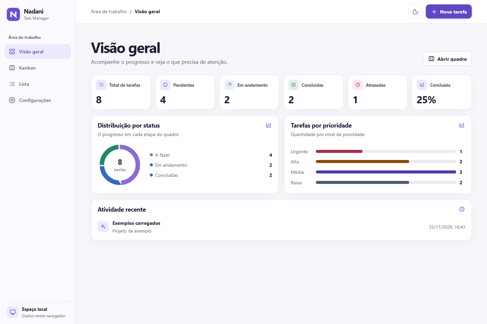
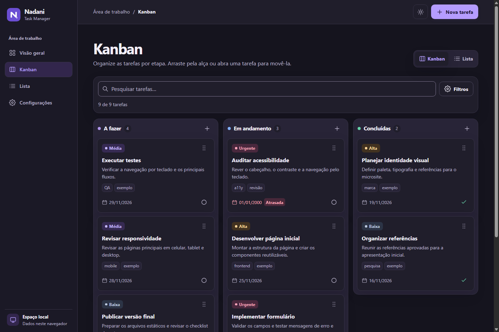
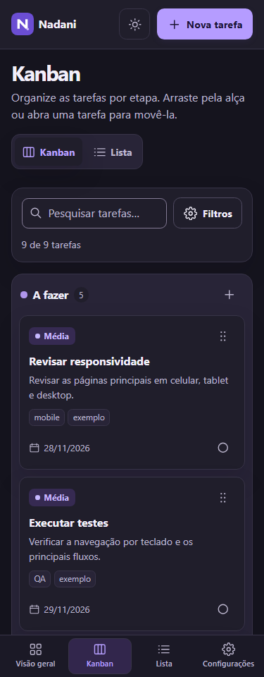

# Nadani Task Manager

Aplicação web de produtividade com quadro Kanban, lista de tarefas e dashboard. Foi desenvolvida como **demonstração de portfólio da Nadani Productions**, para apresentar a clientes uma implementação completa de gerenciamento de tarefas, interações acessíveis e persistência no navegador.

A aplicação funciona localmente no navegador. A hospedagem estática disponibiliza os arquivos do aplicativo, enquanto as tarefas, preferências e atividades ficam no dispositivo que as criou.

## Capturas

**Dashboard no tema claro**



**Kanban no tema escuro**



**Kanban em um viewport de 375 px**



Veja também a [tela de boas-vindas](docs/screenshots/boas-vindas.png). As capturas foram feitas no Chrome usando dados fictícios do exemplo e tarefas criadas durante o teste.

## Funcionalidades

- Criar, editar, consultar, concluir, reabrir e excluir tarefas. A exclusão exige confirmação e pode ser desfeita por dez segundos.
- Mover cartões entre colunas e reordená-los com mouse ou toque. Em **Detalhes da tarefa**, use **Status**, **Subir** e **Descer** por toque ou teclado.
- Pesquisar por título, descrição, categoria e etiquetas, sem distinção de acentos. Combine filtros de status, prioridade, categoria, atraso e conclusão. A pesquisa e os filtros são compartilhados entre o Kanban e a Lista durante a sessão.
- Ordenar a lista por criação, vencimento, prioridade, status ou título.
- Consultar seis indicadores recalculados a partir das tarefas, gráficos por status e prioridade e histórico recente.
- Usar tema claro, escuro ou do sistema, e escolher a visualização inicial.
- Exportar JSON ou CSV, mesclar ou substituir tarefas de um backup JSON e limpar os dados locais mediante confirmação.
- Carregar tarefas fictícias de exemplo por escolha explícita. Quando já há tarefas, a confirmação adiciona aos dados existentes as tarefas com a etiqueta exemplo.

## Execução local

Baixe ou clone o projeto, abra o terminal na pasta `nadani-task-manager` e execute:

```sh
npm start
```

Abra `http://127.0.0.1:4174/nadani-task-manager/`. O servidor incluído usa Node.js 22 ou superior e simula o subdiretório do GitHub Pages. É possível usar outro servidor estático. Para carregar os módulos ES, use HTTP local em vez de abrir o HTML diretamente no sistema de arquivos. O projeto dispensa instalação de dependências, compilação e backend de aplicação.

## Como usar

1. Use **Nova tarefa** e preencha o título obrigatório. As demais informações ajudam na priorização e nos filtros.
2. Abra **Kanban** para organizar o trabalho por etapa. Arraste pela alça pontilhada. Se preferir, abra a tarefa e altere o status ou a posição nos controles do modal. Use **Escape** para cancelar um arraste ou fechar um modal.
3. Na **Lista**, use **Ordenar por** para mudar a ordem de leitura. A ordem manual do quadro é independente da ordenação da lista.
4. Use **Visão geral** para acompanhar prazos, volume e conclusão. Tarefas feitas ficam fora do indicador de atraso, mesmo que tenham vencimento anterior.
5. Em **Configurações**, altere o tema e a tela inicial, faça backups ou limpe o espaço local.

## Dados locais e backups

- O LocalStorage guarda um objeto versionado com tarefas, preferências e até 35 eventos. Cada tarefa tem um ID único, status, prioridade, ordem na coluna e datas de criação, atualização e conclusão em ISO 8601. Vencimentos são datas de calendário no formato `AAAA-MM-DD`.
- O armazenamento é vinculado à origem do site e ao perfil do navegador. Guarde um backup antes de trocar de navegador ou limpar os dados.
- Se houver JSON inválido ou estrutura inconsistente, os dados originais ficam intactos e o aplicativo mostra as tarefas recuperáveis. O aviso permite baixar o conteúdo original e, mediante confirmação, gravar os registros recuperados. Se outra aba alterou o armazenamento, recarregue antes de tentar gravar.
- A exportação JSON contém a versão e as tarefas, incluindo a ordem. **Mesclar** adiciona o conteúdo do arquivo e gera IDs novos para colisões. **Substituir** troca o conjunto de tarefas e reinicia o histórico após confirmação. Preferências e histórico ficam fora do backup.
- O CSV serve para consulta em planilhas. Os campos são escapados e os valores que poderiam ser interpretados como fórmulas recebem um prefixo de texto. A importação aceita somente JSON versionado, com até 8 MiB e 2.000 tarefas.

## Arquitetura e tecnologias

HTML5 semântico, CSS3 com Grid e Flexbox, JavaScript ES6+ em módulos e ícones SVG originais. O arraste usa Pointer Events e os modais usam o elemento nativo `dialog`. Os componentes recebem dados validados e inserem textos do usuário via `textContent`. O projeto usa APIs nativas e nenhuma biblioteca de produção.

```text
nadani-task-manager/
├── index.html
├── css/
│   ├── main.css
│   ├── components.css
│   └── responsive.css
├── js/
│   ├── app.js              # Rotas internas, eventos e gravação das alterações
│   ├── task.js             # Modelo, validação, ordem, pesquisa e métricas
│   ├── storage.js          # Leitura, validação e gravação versionada
│   ├── transfer.js         # JSON, CSV, mesclagem e downloads
│   ├── dashboard.js        # Indicadores, gráficos e histórico
│   ├── views.js            # Quadro, cartões e lista
│   ├── modals.js           # Edição, detalhes, confirmação e foco
│   ├── drag.js             # Arraste de cartões via Pointer Events
│   ├── dom.js              # Construção de elementos e ícones
│   └── demo.js             # Dados fictícios opcionais
├── assets/icons/
├── docs/screenshots/
├── tests/
├── tools/serve.mjs
├── package.json
├── README.md
└── LICENSE
```

### Personalização

- **Marca e textos** em `index.html` e `assets/icons/logo.svg`.
- **Paletas dos dois temas** nas variáveis de `css/main.css`. Breakpoints em `css/responsive.css`.
- **Estados, prioridades e limites de campos** em `js/task.js`. Ao mudar identificadores persistidos, atualize as opções do HTML e trate a migração do formato em `js/storage.js` e `js/transfer.js`.
- **Exemplos e categorias fictícias** em `js/demo.js`.

## Testes

```sh
npm test
npm run test:browser
npm run test:browser -- --screenshots
```

Os testes unitários usam `node:test`. A suíte de navegador usa Chrome, Chromium ou Edge em modo headless via protocolo DevTools. Se necessário, aponte a variável `BROWSER_PATH` para o executável. O último comando também regenera as capturas.

### About do repositório

> Professional Kanban task management application built with vanilla JavaScript, featuring drag-and-drop, analytics, local persistence and responsive design.

## Limitações e crédito

A aplicação demonstra um fluxo de trabalho individual no navegador. A versão tem armazenamento local, sem contas, sincronização, compartilhamento ou colaboração em tempo real. Cotas e permissões de armazenamento são controladas pelo navegador. Excluir os dados do site no navegador remove o espaço de tarefas daquele perfil.

[Developed by Nadani Productions](https://nadani.space) · [Licença MIT](LICENSE)
